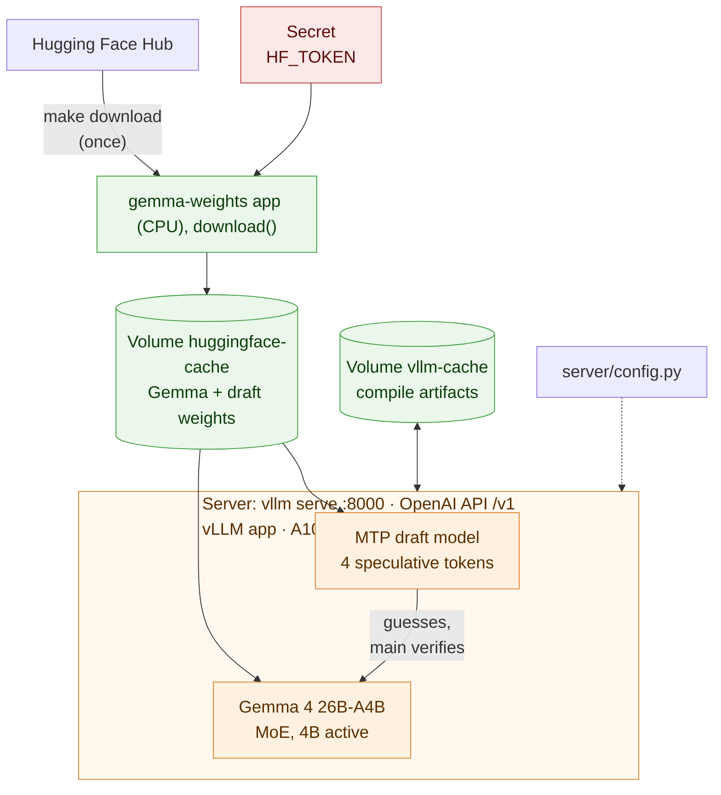
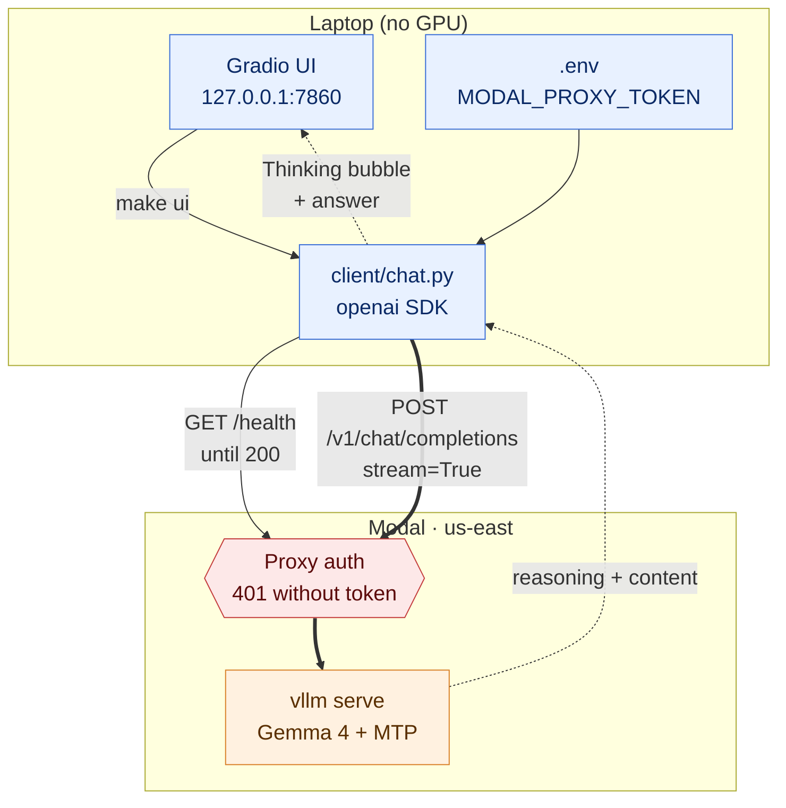

# vLLM and SGLang on Modal

Serve Gemma 4 (26B-A4B) as an OpenAI-compatible API on a Modal GPU (A100-80GB) with vLLM or SGLang, chat with it from the terminal or a browser, and benchmark the two engines against each other.

```
server/config.py             all settings: model, GPU, app name, region
server/weights.py            shared weights Volume + `make download` (CPU)
server/vllm_inference.py     Modal app: image and vLLM server
server/sglang_inference.py   second Modal app: the same model served by SGLang
bench/compare.py             vLLM vs SGLang benchmark, writes reports/<timestamp>/
client/chat.py               terminal chat + shared client helpers
client/ui.py                 Gradio browser chat
tests/smoke_test.py          starts a temporary server and checks that it answers
```

## Setup (once)

1. Install [uv](https://docs.astral.sh/uv/), then run `uv sync` and `uv run modal setup`.
2. Accept the Gemma license on Hugging Face, then store your token:
   `uv run modal secret create huggingface-secret HF_TOKEN=hf_...`
3. `make proxy-token` creates a Modal proxy token and saves it in `.env` as `MODAL_PROXY_TOKEN`. Both servers use Modal proxy auth: without the token, Modal answers 401 and starts no container.
4. `make download` fetches the model weights into a Modal Volume (CPU, ~50 GB).
5. `make deploy-vllm` and `make deploy-sglang`.

## Use

| Command | What it does |
|---|---|
| `make chat` | Terminal chat with vLLM. `make chat ENGINE=sglang` for SGLang. `python -m client.chat --help` for options. |
| `make ui` | Browser chat at http://127.0.0.1:7860. `make ui ENGINE=sglang` for SGLang. |
| `make test` | Smoke test on a temporary GPU server. |
| `make serve-vllm` | Dev copy that reloads on code changes. Pass its URL with `--url`. |
| `make deploy-sglang` | Deploy the SGLang server. `make serve-sglang` for a dev copy. Chat with it: `python -m client.chat --engine sglang` (also `client.ui`). |
| `make compare` | Deploy both servers, benchmark them, write `reports/<timestamp>/report.md`. |
| `make compare-quick` | Same, 2 load levels and the chat scenario only. |
| `make remove` | Stop both apps and their containers (GPU billing stops now). Deploy again before the next use. |

The first request after 15 idle minutes waits for a cold start (about 3 minutes).
The GPU is billed while a container runs, including those 15 idle minutes.

## Gradio UI
### 1. Deploy: weights and server



### 2. Chat: Gradio to Gemma



## Benchmark: vLLM vs SGLang

`make compare` sends the same load to both servers from a Modal CPU container in
their region, at 1, 4, 16 and 32 concurrent requests, for two scenarios: chat
(~250 tokens in) and long-prompt (~4000 tokens in), 256 tokens out each.
Thinking is off and every request generates exactly 256 tokens, so both engines
do the same work.

The report has, per engine and load level: TTFT, TPOT, TTLT (p50/p95), total
and per-user tokens/s, ITL p99, requests/s, goodput (share of requests with
TTFT < 1 s and TPOT < 50 ms), error rate and cost per 1M output tokens. Charts
show each metric against concurrency, plus throughput against per-user speed:
the engine whose curve is further up and right is better at every load.

Both servers stay up for 15 minutes after the run. `make remove` stops them right away.
If SGLang runs out of GPU memory with speculative decoding on one GPU, set
`sglang_mtp=False` in `server/config.py`; the report then says "SGLang (no MTP)".
