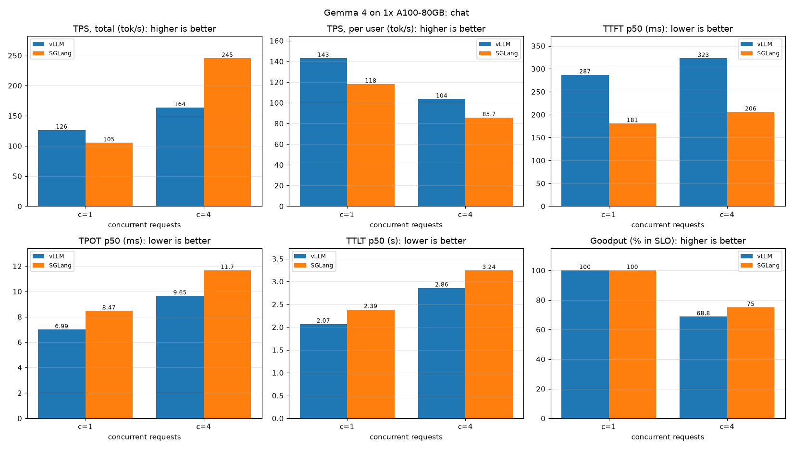

# Gemma 4: vLLM vs SGLang

- Model: `google/gemma-4-26B-A4B-it` on 1x A100-80GB ($2.5/h), region us-east
- Speculative decoding (`google/gemma-4-26B-A4B-it-assistant`): vLLM on, SGLang on
- Thinking off, fixed output length (`ignore_eos`), unique prompts (no prefix cache)
- SLO for goodput: TTFT < 1000 ms and TPOT < 50 ms
- Time until /health answered: vLLM 251 s, SGLang 232 s (minutes = cold start, seconds = already warm)

## Scenario: chat (~257 tokens in, 256 out)

**Verdict** (vLLM vs SGLang)

- One user (c=1): TTFT SGLang (287 vs 181 ms), TPOT vLLM (6.99 vs 8.47 ms)
- High load (c=4): throughput SGLang (164 vs 245 tok/s), cost per 1M tokens SGLang (4.24 vs 2.83 $)
- Goodput at c=4: SGLang (68.8 vs 75 %)

| c | metric | vLLM | SGLang | better |
|---|---|---|---|---|
| 1 | TTFT p50 (ms) | 287 | 181 | SGLang |
| 1 | TTFT p95 (ms) | 419 | 986 | vLLM |
| 1 | TPOT p50 (ms) | 6.99 | 8.47 | vLLM |
| 1 | TPOT p95 (ms) | 7.17 | 9.34 | vLLM |
| 1 | TTLT p50 (s) | 2.07 | 2.39 | vLLM |
| 1 | TTLT p95 (s) | 2.25 | 3.02 | vLLM |
| 1 | ITL p99, gap between chunks (ms) | 22.9 | 24.6 | vLLM |
| 1 | TPS, total (tok/s) | 126 | 105 | vLLM |
| 1 | TPS, per user (tok/s) | 143 | 118 | vLLM |
| 1 | Requests/s | 0.494 | 0.411 | vLLM |
| 1 | Goodput (% in SLO) | 100 | 100 | tie |
| 1 | Errors (%) | 0 | 0 | tie |
| 1 | Cost per 1M output tokens ($) | 5.49 | 6.59 | vLLM |
| 4 | TTFT p50 (ms) | 323 | 206 | SGLang |
| 4 | TTFT p95 (ms) | 5,265 | 3,877 | SGLang |
| 4 | TPOT p50 (ms) | 9.65 | 11.7 | vLLM |
| 4 | TPOT p95 (ms) | 45.4 | 12.8 | SGLang |
| 4 | TTLT p50 (s) | 2.86 | 3.24 | vLLM |
| 4 | TTLT p95 (s) | 16.8 | 7.15 | SGLang |
| 4 | ITL p99, gap between chunks (ms) | 41.8 | 86 | vLLM |
| 4 | TPS, total (tok/s) | 164 | 245 | SGLang |
| 4 | TPS, per user (tok/s) | 104 | 85.7 | vLLM |
| 4 | Requests/s | 0.64 | 0.958 | SGLang |
| 4 | Goodput (% in SLO) | 68.8 | 75 | SGLang |
| 4 | Errors (%) | 0 | 0 | tie |
| 4 | Cost per 1M output tokens ($) | 4.24 | 2.83 | SGLang |

## Metrics

- **TTFT**: time to first token. What a user waits before text appears.
- **TPOT**: time per output token after the first: (TTLT - TTFT) / (tokens - 1).
- **TTLT**: time to last token, the whole request.
- **TPS, total**: output tokens per second of the whole server (throughput, cost).
- **TPS, per user**: 1 / TPOT, the streaming speed one user sees.
- **ITL p99**: 99th percentile pause between streamed chunks (stutter).
- **Goodput**: share of requests that met the SLO above.
- **Cost per 1M output tokens**: GPU price / total TPS, with the GPU fully used.

c = concurrent requests. Raw timings: `results.json`.
