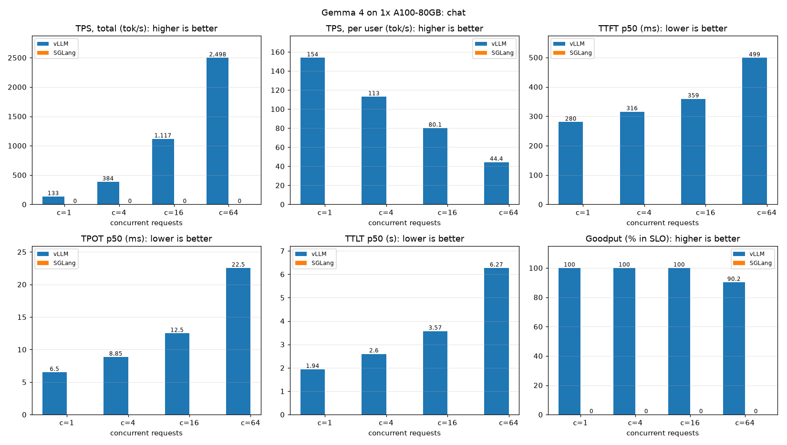
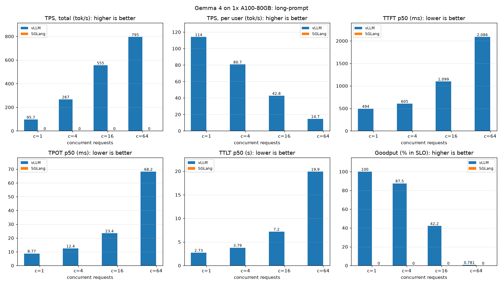

# Gemma 4: vLLM vs SGLang

- Model: `google/gemma-4-26B-A4B-it` on 1x A100-80GB ($2.5/h), region us-east
- Speculative decoding (`google/gemma-4-26B-A4B-it-assistant`): vLLM on, SGLang on
- Thinking off, fixed output length (`ignore_eos`), unique prompts (no prefix cache)
- SLO for goodput: TTFT < 1000 ms and TPOT < 50 ms
- Time until /health answered: vLLM 2 s, SGLang 2 s (minutes = cold start, seconds = already warm)

## Scenario: chat (~255 tokens in, 256 out)

**Verdict** (vLLM vs SGLang)

- One user (c=1): TTFT - (280 vs - ms), TPOT - (6.5 vs - ms)
- High load (c=64): throughput vLLM (2,498 vs 0 tok/s), cost per 1M tokens - (0.278 vs - $)
- Goodput at c=64: vLLM (90.2 vs 0 %)

| c | metric | vLLM | SGLang | better |
|---|---|---|---|---|
| 1 | TTFT p50 (ms) | 280 | - | - |
| 1 | TTFT p95 (ms) | 289 | - | - |
| 1 | TPOT p50 (ms) | 6.5 | - | - |
| 1 | TPOT p95 (ms) | 6.82 | - | - |
| 1 | TTLT p50 (s) | 1.94 | - | - |
| 1 | TTLT p95 (s) | 2.02 | - | - |
| 1 | ITL p99, gap between chunks (ms) | 22.6 | - | - |
| 1 | TPS, total (tok/s) | 133 | 0 | vLLM |
| 1 | TPS, per user (tok/s) | 154 | - | - |
| 1 | Requests/s | 0.52 | 0 | vLLM |
| 1 | Goodput (% in SLO) | 100 | 0 | vLLM |
| 1 | Errors (%) | 0 | 100 | vLLM |
| 1 | Cost per 1M output tokens ($) | 5.21 | - | - |
| 4 | TTFT p50 (ms) | 316 | - | - |
| 4 | TTFT p95 (ms) | 366 | - | - |
| 4 | TPOT p50 (ms) | 8.85 | - | - |
| 4 | TPOT p95 (ms) | 9.57 | - | - |
| 4 | TTLT p50 (s) | 2.6 | - | - |
| 4 | TTLT p95 (s) | 2.76 | - | - |
| 4 | ITL p99, gap between chunks (ms) | 41 | - | - |
| 4 | TPS, total (tok/s) | 384 | 0 | vLLM |
| 4 | TPS, per user (tok/s) | 113 | - | - |
| 4 | Requests/s | 1.5 | 0 | vLLM |
| 4 | Goodput (% in SLO) | 100 | 0 | vLLM |
| 4 | Errors (%) | 0 | 100 | vLLM |
| 4 | Cost per 1M output tokens ($) | 1.81 | - | - |
| 16 | TTFT p50 (ms) | 359 | - | - |
| 16 | TTFT p95 (ms) | 518 | - | - |
| 16 | TPOT p50 (ms) | 12.5 | - | - |
| 16 | TPOT p95 (ms) | 13.8 | - | - |
| 16 | TTLT p50 (s) | 3.57 | - | - |
| 16 | TTLT p95 (s) | 3.92 | - | - |
| 16 | ITL p99, gap between chunks (ms) | 48.9 | - | - |
| 16 | TPS, total (tok/s) | 1,117 | 0 | vLLM |
| 16 | TPS, per user (tok/s) | 80.1 | - | - |
| 16 | Requests/s | 4.36 | 0 | vLLM |
| 16 | Goodput (% in SLO) | 100 | 0 | vLLM |
| 16 | Errors (%) | 0 | 100 | vLLM |
| 16 | Cost per 1M output tokens ($) | 0.622 | - | - |
| 64 | TTFT p50 (ms) | 499 | - | - |
| 64 | TTFT p95 (ms) | 1,207 | - | - |
| 64 | TPOT p50 (ms) | 22.5 | - | - |
| 64 | TPOT p95 (ms) | 25.6 | - | - |
| 64 | TTLT p50 (s) | 6.27 | - | - |
| 64 | TTLT p95 (s) | 7.29 | - | - |
| 64 | ITL p99, gap between chunks (ms) | 125 | - | - |
| 64 | TPS, total (tok/s) | 2,498 | 0 | vLLM |
| 64 | TPS, per user (tok/s) | 44.4 | - | - |
| 64 | Requests/s | 9.76 | 0 | vLLM |
| 64 | Goodput (% in SLO) | 90.2 | 0 | vLLM |
| 64 | Errors (%) | 0 | 100 | vLLM |
| 64 | Cost per 1M output tokens ($) | 0.278 | - | - |

## Scenario: long-prompt (~3057 tokens in, 256 out)

**Verdict** (vLLM vs SGLang)

- One user (c=1): TTFT - (494 vs - ms), TPOT - (8.77 vs - ms)
- High load (c=64): throughput vLLM (795 vs 0 tok/s), cost per 1M tokens - (0.874 vs - $)
- Goodput at c=64: vLLM (0.781 vs 0 %)

| c | metric | vLLM | SGLang | better |
|---|---|---|---|---|
| 1 | TTFT p50 (ms) | 494 | - | - |
| 1 | TTFT p95 (ms) | 551 | - | - |
| 1 | TPOT p50 (ms) | 8.77 | - | - |
| 1 | TPOT p95 (ms) | 9.46 | - | - |
| 1 | TTLT p50 (s) | 2.73 | - | - |
| 1 | TTLT p95 (s) | 2.9 | - | - |
| 1 | ITL p99, gap between chunks (ms) | 24.7 | - | - |
| 1 | TPS, total (tok/s) | 95.7 | 0 | vLLM |
| 1 | TPS, per user (tok/s) | 114 | - | - |
| 1 | Requests/s | 0.374 | 0 | vLLM |
| 1 | Goodput (% in SLO) | 100 | 0 | vLLM |
| 1 | Errors (%) | 0 | 100 | vLLM |
| 1 | Cost per 1M output tokens ($) | 7.25 | - | - |
| 4 | TTFT p50 (ms) | 605 | - | - |
| 4 | TTFT p95 (ms) | 1,181 | - | - |
| 4 | TPOT p50 (ms) | 12.4 | - | - |
| 4 | TPOT p95 (ms) | 14 | - | - |
| 4 | TTLT p50 (s) | 3.79 | - | - |
| 4 | TTLT p95 (s) | 4.13 | - | - |
| 4 | ITL p99, gap between chunks (ms) | 140 | - | - |
| 4 | TPS, total (tok/s) | 267 | 0 | vLLM |
| 4 | TPS, per user (tok/s) | 80.7 | - | - |
| 4 | Requests/s | 1.04 | 0 | vLLM |
| 4 | Goodput (% in SLO) | 87.5 | 0 | vLLM |
| 4 | Errors (%) | 0 | 100 | vLLM |
| 4 | Cost per 1M output tokens ($) | 2.6 | - | - |
| 16 | TTFT p50 (ms) | 1,099 | - | - |
| 16 | TTFT p95 (ms) | 3,364 | - | - |
| 16 | TPOT p50 (ms) | 23.4 | - | - |
| 16 | TPOT p95 (ms) | 27.9 | - | - |
| 16 | TTLT p50 (s) | 7.2 | - | - |
| 16 | TTLT p95 (s) | 9.55 | - | - |
| 16 | ITL p99, gap between chunks (ms) | 167 | - | - |
| 16 | TPS, total (tok/s) | 555 | 0 | vLLM |
| 16 | TPS, per user (tok/s) | 42.8 | - | - |
| 16 | Requests/s | 2.17 | 0 | vLLM |
| 16 | Goodput (% in SLO) | 42.2 | 0 | vLLM |
| 16 | Errors (%) | 0 | 100 | vLLM |
| 16 | Cost per 1M output tokens ($) | 1.25 | - | - |
| 64 | TTFT p50 (ms) | 2,086 | - | - |
| 64 | TTFT p95 (ms) | 13,820 | - | - |
| 64 | TPOT p50 (ms) | 68.2 | - | - |
| 64 | TPOT p95 (ms) | 77.5 | - | - |
| 64 | TTLT p50 (s) | 19.9 | - | - |
| 64 | TTLT p95 (s) | 31.4 | - | - |
| 64 | ITL p99, gap between chunks (ms) | 190 | - | - |
| 64 | TPS, total (tok/s) | 795 | 0 | vLLM |
| 64 | TPS, per user (tok/s) | 14.7 | - | - |
| 64 | Requests/s | 3.1 | 0 | vLLM |
| 64 | Goodput (% in SLO) | 0.781 | 0 | vLLM |
| 64 | Errors (%) | 0 | 100 | vLLM |
| 64 | Cost per 1M output tokens ($) | 0.874 | - | - |

## Metrics

- **TTFT**: time to first token. What a user waits before text appears.
- **TPOT**: time per output token after the first: (TTLT - TTFT) / (tokens - 1).
- **TTLT**: time to last token, the whole request.
- **TPS, total**: output tokens per second of the whole server (throughput, cost).
- **TPS, per user**: 1 / TPOT, the streaming speed one user sees.
- **ITL p99**: 99th percentile pause between streamed chunks (stutter).
- **Goodput**: share of requests that met the SLO above.
- **Cost per 1M output tokens**: GPU price / total TPS, with the GPU fully used.

c = concurrent requests. Raw timings: `results.json`.
