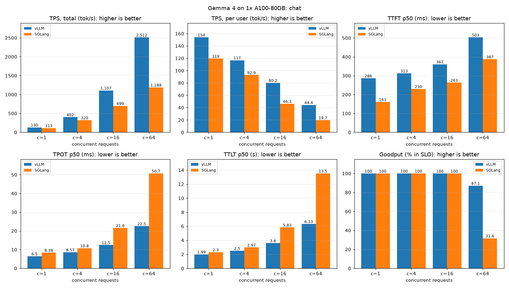
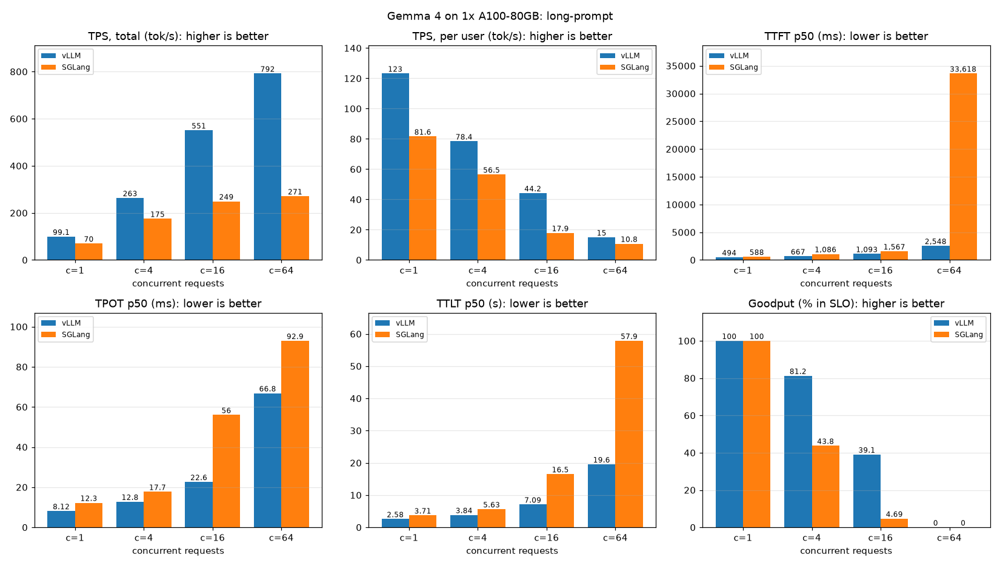

# Gemma 4: vLLM vs SGLang

- Model: `google/gemma-4-26B-A4B-it` on 1x A100-80GB ($2.5/h), region us-east
- Speculative decoding (`google/gemma-4-26B-A4B-it-assistant`): vLLM on, SGLang on
- Thinking off, fixed output length (`ignore_eos`), unique prompts (no prefix cache)
- SLO for goodput: TTFT < 1000 ms and TPOT < 50 ms
- Time until /health answered: vLLM 13 s, SGLang 39 s (minutes = cold start, seconds = already warm)

## Scenario: chat (~258 tokens in, 256 out)

**Verdict** (vLLM vs SGLang)

- One user (c=1): TTFT SGLang (286 vs 161 ms), TPOT vLLM (6.5 vs 8.38 ms)
- High load (c=64): throughput vLLM (2,512 vs 1,188 tok/s), cost per 1M tokens vLLM (0.277 vs 0.585 $)
- Goodput at c=64: vLLM (87.1 vs 31.6 %)

| c | metric | vLLM | SGLang | better |
|---|---|---|---|---|
| 1 | TTFT p50 (ms) | 286 | 161 | SGLang |
| 1 | TTFT p95 (ms) | 341 | 176 | SGLang |
| 1 | TPOT p50 (ms) | 6.5 | 8.38 | vLLM |
| 1 | TPOT p95 (ms) | 7.05 | 8.89 | vLLM |
| 1 | TTLT p50 (s) | 1.99 | 2.3 | vLLM |
| 1 | TTLT p95 (s) | 2.08 | 2.43 | vLLM |
| 1 | ITL p99, gap between chunks (ms) | 20.8 | 23.8 | vLLM |
| 1 | TPS, total (tok/s) | 130 | 113 | vLLM |
| 1 | TPS, per user (tok/s) | 154 | 119 | vLLM |
| 1 | Requests/s | 0.508 | 0.441 | vLLM |
| 1 | Goodput (% in SLO) | 100 | 100 | tie |
| 1 | Errors (%) | 0 | 0 | tie |
| 1 | Cost per 1M output tokens ($) | 5.34 | 6.16 | vLLM |
| 4 | TTFT p50 (ms) | 313 | 230 | SGLang |
| 4 | TTFT p95 (ms) | 371 | 313 | SGLang |
| 4 | TPOT p50 (ms) | 8.57 | 10.8 | vLLM |
| 4 | TPOT p95 (ms) | 9.32 | 14 | vLLM |
| 4 | TTLT p50 (s) | 2.5 | 2.97 | vLLM |
| 4 | TTLT p95 (s) | 2.68 | 3.81 | vLLM |
| 4 | ITL p99, gap between chunks (ms) | 37.9 | 81.5 | vLLM |
| 4 | TPS, total (tok/s) | 402 | 320 | vLLM |
| 4 | TPS, per user (tok/s) | 117 | 92.9 | vLLM |
| 4 | Requests/s | 1.57 | 1.25 | vLLM |
| 4 | Goodput (% in SLO) | 100 | 100 | tie |
| 4 | Errors (%) | 0 | 0 | tie |
| 4 | Cost per 1M output tokens ($) | 1.73 | 2.17 | vLLM |
| 16 | TTFT p50 (ms) | 361 | 263 | SGLang |
| 16 | TTFT p95 (ms) | 586 | 497 | SGLang |
| 16 | TPOT p50 (ms) | 12.5 | 21.6 | vLLM |
| 16 | TPOT p95 (ms) | 13.7 | 24.6 | vLLM |
| 16 | TTLT p50 (s) | 3.6 | 5.83 | vLLM |
| 16 | TTLT p95 (s) | 3.96 | 6.43 | vLLM |
| 16 | ITL p99, gap between chunks (ms) | 53.6 | 127 | vLLM |
| 16 | TPS, total (tok/s) | 1,107 | 699 | vLLM |
| 16 | TPS, per user (tok/s) | 80.2 | 46.3 | vLLM |
| 16 | Requests/s | 4.33 | 2.73 | vLLM |
| 16 | Goodput (% in SLO) | 100 | 100 | tie |
| 16 | Errors (%) | 0 | 0 | tie |
| 16 | Cost per 1M output tokens ($) | 0.627 | 0.993 | vLLM |
| 64 | TTFT p50 (ms) | 503 | 387 | SGLang |
| 64 | TTFT p95 (ms) | 1,321 | 1,549 | vLLM |
| 64 | TPOT p50 (ms) | 22.5 | 50.7 | vLLM |
| 64 | TPOT p95 (ms) | 25.5 | 57.3 | vLLM |
| 64 | TTLT p50 (s) | 6.33 | 13.5 | vLLM |
| 64 | TTLT p95 (s) | 7.41 | 15.3 | vLLM |
| 64 | ITL p99, gap between chunks (ms) | 148 | 356 | vLLM |
| 64 | TPS, total (tok/s) | 2,512 | 1,188 | vLLM |
| 64 | TPS, per user (tok/s) | 44.4 | 19.7 | vLLM |
| 64 | Requests/s | 9.81 | 4.64 | vLLM |
| 64 | Goodput (% in SLO) | 87.1 | 31.6 | vLLM |
| 64 | Errors (%) | 0 | 0 | tie |
| 64 | Cost per 1M output tokens ($) | 0.277 | 0.585 | vLLM |

## Scenario: long-prompt (~3058 tokens in, 256 out)

**Verdict** (vLLM vs SGLang)

- One user (c=1): TTFT vLLM (494 vs 588 ms), TPOT vLLM (8.12 vs 12.3 ms)
- High load (c=64): throughput vLLM (792 vs 271 tok/s), cost per 1M tokens vLLM (0.877 vs 2.56 $)
- Goodput at c=64: tie (0 vs 0 %)

| c | metric | vLLM | SGLang | better |
|---|---|---|---|---|
| 1 | TTFT p50 (ms) | 494 | 588 | vLLM |
| 1 | TTFT p95 (ms) | 519 | 613 | vLLM |
| 1 | TPOT p50 (ms) | 8.12 | 12.3 | vLLM |
| 1 | TPOT p95 (ms) | 8.9 | 12.7 | vLLM |
| 1 | TTLT p50 (s) | 2.58 | 3.71 | vLLM |
| 1 | TTLT p95 (s) | 2.76 | 3.83 | vLLM |
| 1 | ITL p99, gap between chunks (ms) | 28.9 | 35.1 | vLLM |
| 1 | TPS, total (tok/s) | 99.1 | 70 | vLLM |
| 1 | TPS, per user (tok/s) | 123 | 81.6 | vLLM |
| 1 | Requests/s | 0.387 | 0.273 | vLLM |
| 1 | Goodput (% in SLO) | 100 | 100 | tie |
| 1 | Errors (%) | 0 | 0 | tie |
| 1 | Cost per 1M output tokens ($) | 7.01 | 9.92 | vLLM |
| 4 | TTFT p50 (ms) | 667 | 1,086 | vLLM |
| 4 | TTFT p95 (ms) | 1,195 | 2,093 | vLLM |
| 4 | TPOT p50 (ms) | 12.8 | 17.7 | vLLM |
| 4 | TPOT p95 (ms) | 14.2 | 22.2 | vLLM |
| 4 | TTLT p50 (s) | 3.84 | 5.63 | vLLM |
| 4 | TTLT p95 (s) | 4.23 | 7.53 | vLLM |
| 4 | ITL p99, gap between chunks (ms) | 141 | 507 | vLLM |
| 4 | TPS, total (tok/s) | 263 | 175 | vLLM |
| 4 | TPS, per user (tok/s) | 78.4 | 56.5 | vLLM |
| 4 | Requests/s | 1.03 | 0.684 | vLLM |
| 4 | Goodput (% in SLO) | 81.2 | 43.8 | vLLM |
| 4 | Errors (%) | 0 | 0 | tie |
| 4 | Cost per 1M output tokens ($) | 2.64 | 3.97 | vLLM |
| 16 | TTFT p50 (ms) | 1,093 | 1,567 | vLLM |
| 16 | TTFT p95 (ms) | 3,964 | 7,803 | vLLM |
| 16 | TPOT p50 (ms) | 22.6 | 56 | vLLM |
| 16 | TPOT p95 (ms) | 28 | 67.7 | vLLM |
| 16 | TTLT p50 (s) | 7.09 | 16.5 | vLLM |
| 16 | TTLT p95 (s) | 9.71 | 21.5 | vLLM |
| 16 | ITL p99, gap between chunks (ms) | 165 | 1,052 | vLLM |
| 16 | TPS, total (tok/s) | 551 | 249 | vLLM |
| 16 | TPS, per user (tok/s) | 44.2 | 17.9 | vLLM |
| 16 | Requests/s | 2.15 | 0.973 | vLLM |
| 16 | Goodput (% in SLO) | 39.1 | 4.69 | vLLM |
| 16 | Errors (%) | 0 | 0 | tie |
| 16 | Cost per 1M output tokens ($) | 1.26 | 2.79 | vLLM |
| 64 | TTFT p50 (ms) | 2,548 | 33,618 | vLLM |
| 64 | TTFT p95 (ms) | 13,919 | 41,960 | vLLM |
| 64 | TPOT p50 (ms) | 66.8 | 92.9 | vLLM |
| 64 | TPOT p95 (ms) | 78.3 | 112 | vLLM |
| 64 | TTLT p50 (s) | 19.6 | 57.9 | vLLM |
| 64 | TTLT p95 (s) | 32.2 | 69.4 | vLLM |
| 64 | ITL p99, gap between chunks (ms) | 477 | 1,112 | vLLM |
| 64 | TPS, total (tok/s) | 792 | 271 | vLLM |
| 64 | TPS, per user (tok/s) | 15 | 10.8 | vLLM |
| 64 | Requests/s | 3.09 | 1.06 | vLLM |
| 64 | Goodput (% in SLO) | 0 | 0 | tie |
| 64 | Errors (%) | 0 | 0 | tie |
| 64 | Cost per 1M output tokens ($) | 0.877 | 2.56 | vLLM |

## Metrics

- **TTFT**: time to first token. What a user waits before text appears.
- **TPOT**: time per output token after the first: (TTLT - TTFT) / (tokens - 1).
- **TTLT**: time to last token, the whole request.
- **TPS, total**: output tokens per second of the whole server (throughput, cost).
- **TPS, per user**: 1 / TPOT, the streaming speed one user sees.
- **ITL p99**: 99th percentile pause between streamed chunks (stutter).
- **Goodput**: share of requests that met the SLO above.
- **Cost per 1M output tokens**: GPU price / total TPS, with the GPU fully used.

c = concurrent requests. Raw timings: `results.json`.
