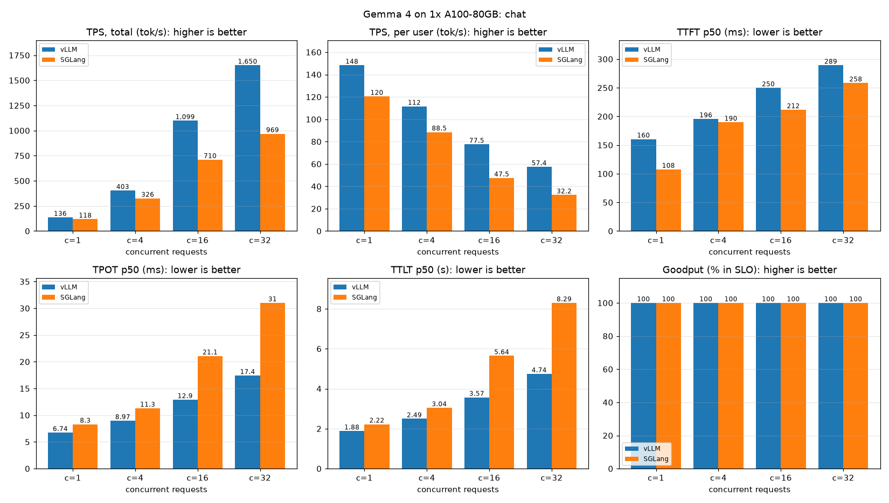
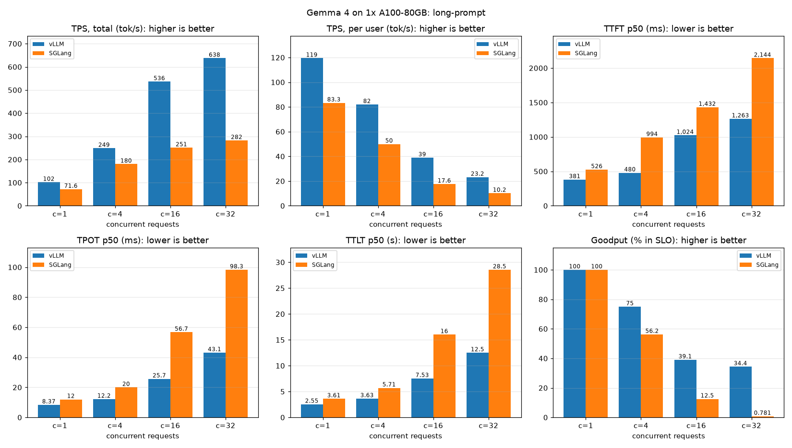

# Gemma 4: vLLM vs SGLang

- Model: `google/gemma-4-26B-A4B-it` on 1x A100-80GB ($2.5/h), region us-east
- Speculative decoding (`google/gemma-4-26B-A4B-it-assistant`): vLLM on, SGLang on
- Thinking off, fixed output length (`ignore_eos`), unique prompts (no prefix cache)
- Load levels with failed requests (measured again): SGLang long-prompt c=32: 1.56 % errors
- SLO for goodput: TTFT < 1000 ms and TPOT < 50 ms
- Time until /health answered: vLLM 254 s, SGLang 34 s (minutes = cold start, seconds = already warm)

## Scenario: chat (~258 tokens in, 256 out)

**Verdict** (vLLM vs SGLang)

- One user (c=1): TTFT SGLang (160 vs 108 ms), TPOT vLLM (6.74 vs 8.3 ms)
- High load (c=32): throughput vLLM (1,650 vs 969 tok/s), cost per 1M tokens vLLM (0.421 vs 0.717 $)
- Goodput at c=32: tie (100 vs 100 %)

| c | metric | vLLM | SGLang | better |
|---|---|---|---|---|
| 1 | TTFT p50 (ms) | 160 | 108 | SGLang |
| 1 | TTFT p95 (ms) | 192 | 143 | SGLang |
| 1 | TPOT p50 (ms) | 6.74 | 8.3 | vLLM |
| 1 | TPOT p95 (ms) | 7.43 | 8.48 | vLLM |
| 1 | TTLT p50 (s) | 1.88 | 2.22 | vLLM |
| 1 | TTLT p95 (s) | 2.06 | 2.26 | vLLM |
| 1 | ITL p99, gap between chunks (ms) | 21.3 | 30.4 | vLLM |
| 1 | TPS, total (tok/s) | 136 | 118 | vLLM |
| 1 | TPS, per user (tok/s) | 148 | 120 | vLLM |
| 1 | Requests/s | 0.53 | 0.46 | vLLM |
| 1 | Goodput (% in SLO) | 100 | 100 | tie |
| 1 | Errors (%) | 0 | 0 | tie |
| 1 | Cost per 1M output tokens ($) | 5.11 | 5.89 | vLLM |
| 4 | TTFT p50 (ms) | 196 | 190 | tie |
| 4 | TTFT p95 (ms) | 261 | 338 | vLLM |
| 4 | TPOT p50 (ms) | 8.97 | 11.3 | vLLM |
| 4 | TPOT p95 (ms) | 9.91 | 12.2 | vLLM |
| 4 | TTLT p50 (s) | 2.49 | 3.04 | vLLM |
| 4 | TTLT p95 (s) | 2.75 | 3.37 | vLLM |
| 4 | ITL p99, gap between chunks (ms) | 40.4 | 82.6 | vLLM |
| 4 | TPS, total (tok/s) | 403 | 326 | vLLM |
| 4 | TPS, per user (tok/s) | 112 | 88.5 | vLLM |
| 4 | Requests/s | 1.58 | 1.27 | vLLM |
| 4 | Goodput (% in SLO) | 100 | 100 | tie |
| 4 | Errors (%) | 0 | 0 | tie |
| 4 | Cost per 1M output tokens ($) | 1.72 | 2.13 | vLLM |
| 16 | TTFT p50 (ms) | 250 | 212 | SGLang |
| 16 | TTFT p95 (ms) | 450 | 471 | vLLM |
| 16 | TPOT p50 (ms) | 12.9 | 21.1 | vLLM |
| 16 | TPOT p95 (ms) | 14.6 | 23.7 | vLLM |
| 16 | TTLT p50 (s) | 3.57 | 5.64 | vLLM |
| 16 | TTLT p95 (s) | 4.01 | 6.25 | vLLM |
| 16 | ITL p99, gap between chunks (ms) | 58 | 139 | vLLM |
| 16 | TPS, total (tok/s) | 1,099 | 710 | vLLM |
| 16 | TPS, per user (tok/s) | 77.5 | 47.5 | vLLM |
| 16 | Requests/s | 4.29 | 2.77 | vLLM |
| 16 | Goodput (% in SLO) | 100 | 100 | tie |
| 16 | Errors (%) | 0 | 0 | tie |
| 16 | Cost per 1M output tokens ($) | 0.632 | 0.978 | vLLM |
| 32 | TTFT p50 (ms) | 289 | 258 | SGLang |
| 32 | TTFT p95 (ms) | 726 | 822 | vLLM |
| 32 | TPOT p50 (ms) | 17.4 | 31 | vLLM |
| 32 | TPOT p95 (ms) | 19.5 | 34.9 | vLLM |
| 32 | TTLT p50 (s) | 4.74 | 8.29 | vLLM |
| 32 | TTLT p95 (s) | 5.45 | 9.37 | vLLM |
| 32 | ITL p99, gap between chunks (ms) | 82.8 | 203 | vLLM |
| 32 | TPS, total (tok/s) | 1,650 | 969 | vLLM |
| 32 | TPS, per user (tok/s) | 57.4 | 32.2 | vLLM |
| 32 | Requests/s | 6.44 | 3.78 | vLLM |
| 32 | Goodput (% in SLO) | 100 | 100 | tie |
| 32 | Errors (%) | 0 | 0 | tie |
| 32 | Cost per 1M output tokens ($) | 0.421 | 0.717 | vLLM |

## Scenario: long-prompt (~3058 tokens in, 256 out)

**Verdict** (vLLM vs SGLang)

- One user (c=1): TTFT vLLM (381 vs 526 ms), TPOT vLLM (8.37 vs 12 ms)
- High load (c=32): throughput vLLM (638 vs 282 tok/s), cost per 1M tokens vLLM (1.09 vs 2.46 $)
- Goodput at c=32: vLLM (34.4 vs 0.781 %)

| c | metric | vLLM | SGLang | better |
|---|---|---|---|---|
| 1 | TTFT p50 (ms) | 381 | 526 | vLLM |
| 1 | TTFT p95 (ms) | 416 | 548 | vLLM |
| 1 | TPOT p50 (ms) | 8.37 | 12 | vLLM |
| 1 | TPOT p95 (ms) | 9.11 | 13.4 | vLLM |
| 1 | TTLT p50 (s) | 2.55 | 3.61 | vLLM |
| 1 | TTLT p95 (s) | 2.71 | 3.95 | vLLM |
| 1 | ITL p99, gap between chunks (ms) | 22.8 | 32.3 | vLLM |
| 1 | TPS, total (tok/s) | 102 | 71.6 | vLLM |
| 1 | TPS, per user (tok/s) | 119 | 83.3 | vLLM |
| 1 | Requests/s | 0.397 | 0.28 | vLLM |
| 1 | Goodput (% in SLO) | 100 | 100 | tie |
| 1 | Errors (%) | 0 | 0 | tie |
| 1 | Cost per 1M output tokens ($) | 6.83 | 9.7 | vLLM |
| 4 | TTFT p50 (ms) | 480 | 994 | vLLM |
| 4 | TTFT p95 (ms) | 2,356 | 2,054 | SGLang |
| 4 | TPOT p50 (ms) | 12.2 | 20 | vLLM |
| 4 | TPOT p95 (ms) | 15.7 | 23.4 | vLLM |
| 4 | TTLT p50 (s) | 3.63 | 5.71 | vLLM |
| 4 | TTLT p95 (s) | 5.81 | 7.54 | vLLM |
| 4 | ITL p99, gap between chunks (ms) | 147 | 505 | vLLM |
| 4 | TPS, total (tok/s) | 249 | 180 | vLLM |
| 4 | TPS, per user (tok/s) | 82 | 50 | vLLM |
| 4 | Requests/s | 0.971 | 0.704 | vLLM |
| 4 | Goodput (% in SLO) | 75 | 56.2 | vLLM |
| 4 | Errors (%) | 0 | 0 | tie |
| 4 | Cost per 1M output tokens ($) | 2.79 | 3.85 | vLLM |
| 16 | TTFT p50 (ms) | 1,024 | 1,432 | vLLM |
| 16 | TTFT p95 (ms) | 3,515 | 7,760 | vLLM |
| 16 | TPOT p50 (ms) | 25.7 | 56.7 | vLLM |
| 16 | TPOT p95 (ms) | 29.3 | 72.7 | vLLM |
| 16 | TTLT p50 (s) | 7.53 | 16 | vLLM |
| 16 | TTLT p95 (s) | 9.45 | 22.2 | vLLM |
| 16 | ITL p99, gap between chunks (ms) | 177 | 1,015 | vLLM |
| 16 | TPS, total (tok/s) | 536 | 251 | vLLM |
| 16 | TPS, per user (tok/s) | 39 | 17.6 | vLLM |
| 16 | Requests/s | 2.1 | 0.98 | vLLM |
| 16 | Goodput (% in SLO) | 39.1 | 12.5 | vLLM |
| 16 | Errors (%) | 0 | 0 | tie |
| 16 | Cost per 1M output tokens ($) | 1.29 | 2.77 | vLLM |
| 32 | TTFT p50 (ms) | 1,263 | 2,144 | vLLM |
| 32 | TTFT p95 (ms) | 7,205 | 14,762 | vLLM |
| 32 | TPOT p50 (ms) | 43.1 | 98.3 | vLLM |
| 32 | TPOT p95 (ms) | 49.7 | 133 | vLLM |
| 32 | TTLT p50 (s) | 12.5 | 28.5 | vLLM |
| 32 | TTLT p95 (s) | 18 | 40.4 | vLLM |
| 32 | ITL p99, gap between chunks (ms) | 190 | 1,816 | vLLM |
| 32 | TPS, total (tok/s) | 638 | 282 | vLLM |
| 32 | TPS, per user (tok/s) | 23.2 | 10.2 | vLLM |
| 32 | Requests/s | 2.49 | 1.1 | vLLM |
| 32 | Goodput (% in SLO) | 34.4 | 0.781 | vLLM |
| 32 | Errors (%) | 0 | 0 | tie |
| 32 | Cost per 1M output tokens ($) | 1.09 | 2.46 | vLLM |

## Metrics

- **TTFT**: time to first token. What a user waits before text appears.
- **TPOT**: time per output token after the first: (TTLT - TTFT) / (tokens - 1).
- **TTLT**: time to last token, the whole request.
- **TPS, total**: output tokens per second of the whole server (throughput, cost).
- **TPS, per user**: 1 / TPOT, the streaming speed one user sees.
- **ITL p99**: 99th percentile pause between streamed chunks (stutter).
- **Goodput**: share of requests that met the SLO above.
- **Cost per 1M output tokens**: GPU price / total TPS, with the GPU fully used.

c = concurrent requests. Raw timings: `results.json`.
